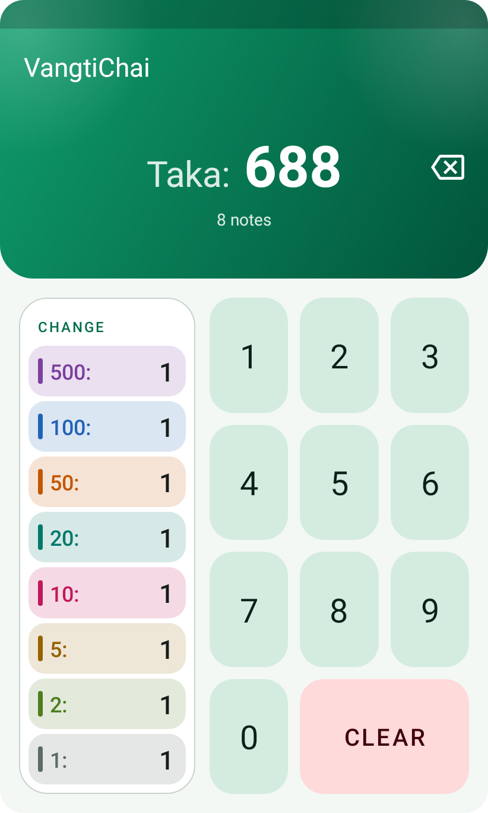
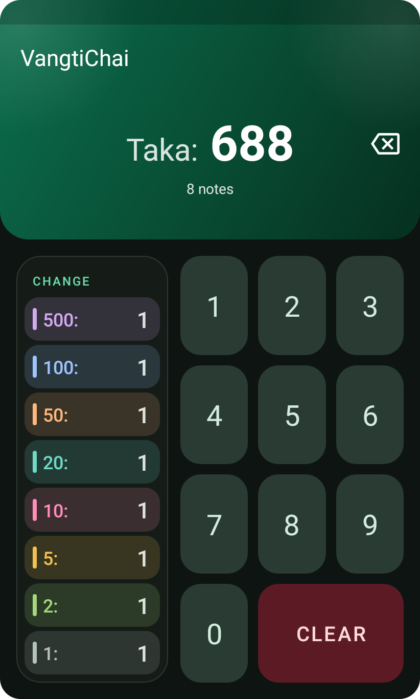
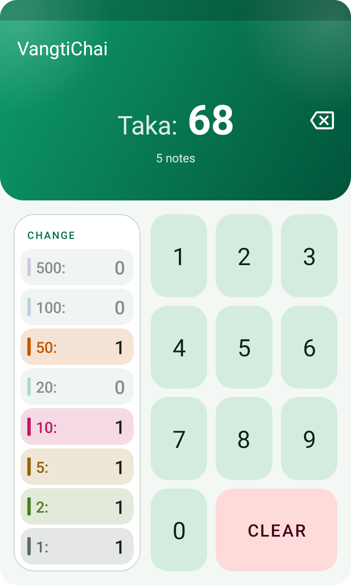
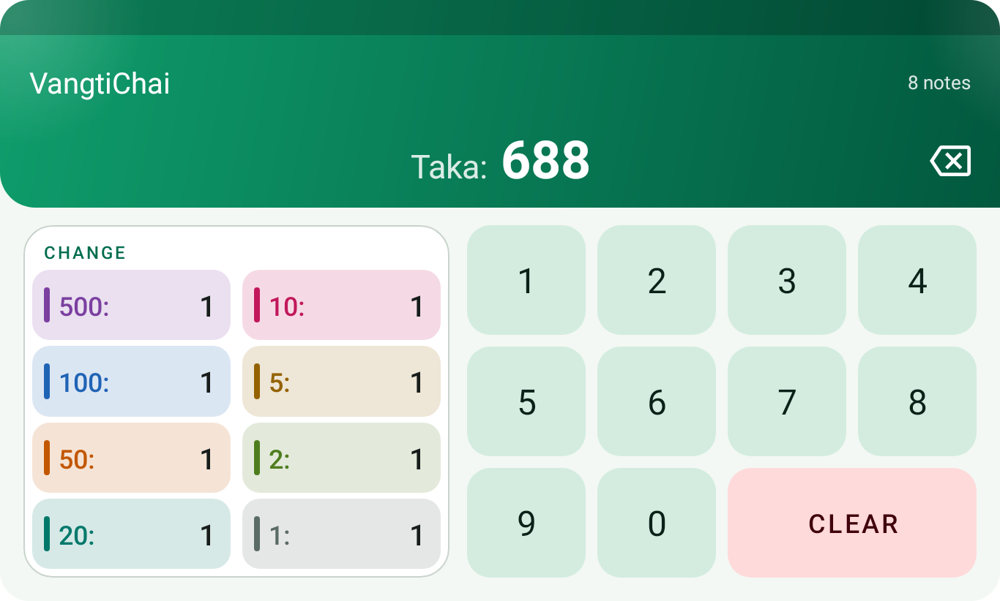
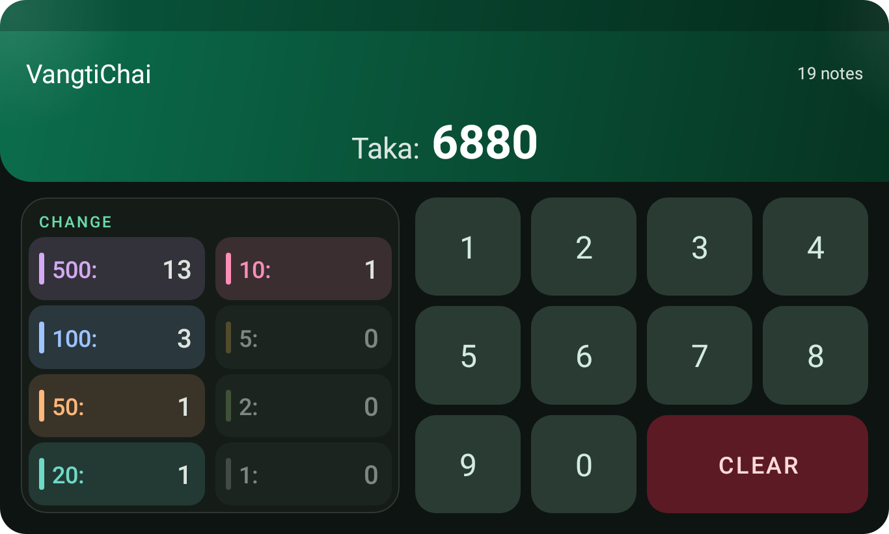
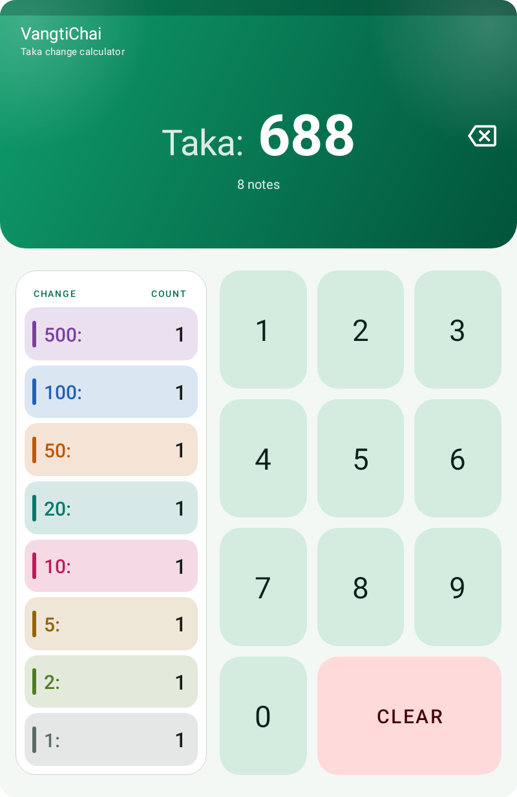
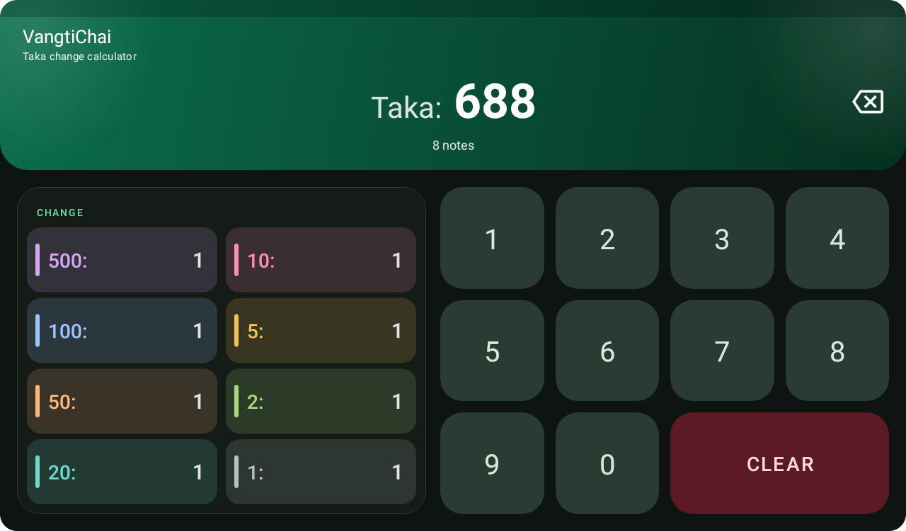
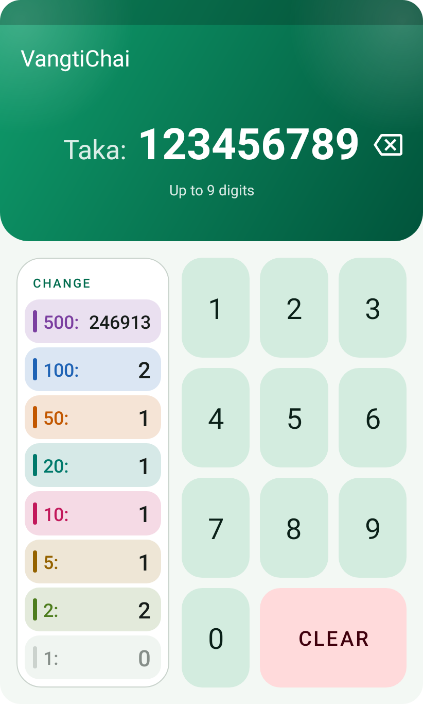
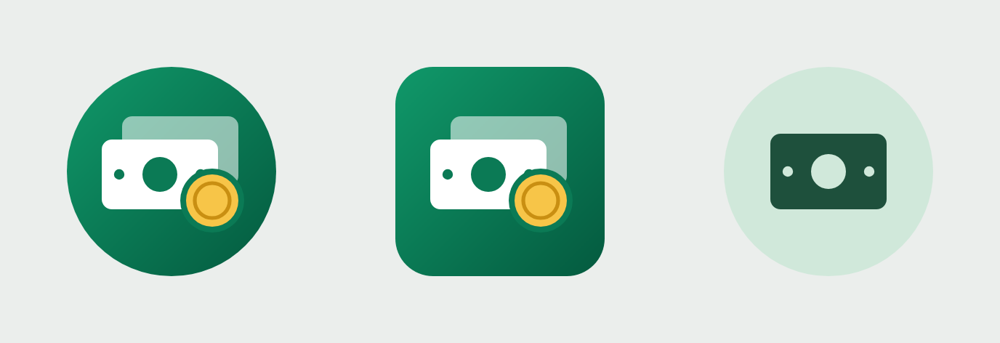

<div align="center">


# VangtiChai

**ভাংতি চাই** &nbsp;·&nbsp; *"I need change"*

A Taka change calculator for Android. Type an amount and see exactly which notes make it up, using as few notes as possible.

<br>


<br>


&nbsp;&nbsp;

&nbsp;&nbsp;


</div>

<br>

## ✨ Features

| Feature | What it does |
|---|---|
| 🔢 **Custom keypad** | A numeric keypad built from scratch with `ConstraintLayout`. Digits are added from the right: tapping 2, 3, 4 shows 2, then 23, then 234. |
| ⌫ **Backspace** | Works like a phone's: tap it to delete the last digit, or hold it to keep deleting until you let go. It sits beside the amount, as in a phone dialer, and only appears once something is typed. |
| 💵 **Instant change table** | Shows how many 500, 100, 50, 20, 10, 5, 2 and 1 Taka notes make up the amount, always using the fewest notes. |
| 🔄 **Survives rotation** | The amount and the change list are saved in `onSaveInstanceState()` and restored when the layout switches between portrait and landscape. |
| 📱 **Phone and tablet layouts** | Four hand-built layouts for phone and tablet, in portrait and landscape. |
| 🎨 **Material 3, light and dark** | A green "Taka" theme with full dark-theme support and edge-to-edge drawing that keeps clear of the status bar, navigation bar and display cutouts. |
| 🌈 **Colour-coded notes** | Each note has its own colour. Notes that are part of the change light up and the rest fade back. |
| ✨ **Small touches** | Counts pop when they change, keys shrink slightly when pressed, and every key press gives haptic feedback. |
| 🛑 **Input limit** | Accepts up to 9 digits (999,999,999 Taka). Typing more shakes the amount and shows *"Up to 9 digits"*. Long amounts and counts shrink to fit, so everything stays on one screen. |
| ⌨️ **Hardware keyboard** | Digits type, <kbd>Backspace</kbd> deletes the last digit, and <kbd>Esc</kbd> or <kbd>C</kbd> clears. Handy on an emulator. |
| ♿ **Accessible** | Screen readers announce the amount as it changes, and each row has a spoken description such as *"1 note of 500 Taka"*. |
| 🖼️ **Adaptive launcher icon** | A custom adaptive icon, including a themed (monochrome) version for Android 13+. |

## 🧮 How it works

The change logic lives in [`ChangeCalculator.kt`](app/src/main/java/com/example/vangtichai/ChangeCalculator.kt), separate from the UI so it can be unit tested on its own:

```kotlin
val NOTES = intArrayOf(500, 100, 50, 20, 10, 5, 2, 1)

fun breakdown(amount: Long): LongArray {
    var remaining = amount
    return LongArray(NOTES.size) { i ->
        val count = remaining / NOTES[i]
        remaining %= NOTES[i]
        count
    }
}
```

It takes the largest note that fits, then repeats with what is left. The Taka note system is *canonical*, which means this greedy approach always gives the smallest number of notes. The unit tests check that against a dynamic-programming solution for every amount from 0 to 2,000.

**Example: 6880 Taka → 19 notes**

| Note | 500 | 100 | 50 | 20 | 10 | 5 | 2 | 1 |
|:-----|:---:|:---:|:--:|:--:|:--:|:-:|:-:|:-:|
| **Count** | 13 | 3 | 1 | 1 | 1 | 0 | 0 | 0 |

## 📸 Screenshots

### Landscape

The change table splits into two columns and the keypad grows to four columns.

<p align="center">
  
  &nbsp;
  
</p>

### Tablet

Tablet layouts use the same arrangement, scaled up, with a subtitle in the app bar.

<p align="center">
  
  &nbsp;
  
</p>

### Input limit and launcher icon

<p align="center">
  
  &nbsp;&nbsp;
  
</p>

## 📐 Layouts

All four layouts are built on `ConstraintLayout` using chains, guidelines and percentage sizing.

| Layout file | Screen | Designed for |
|:--|:--|:--|
| `layout/activity_main.xml` | Phone, portrait | Pixel XL · 411 × 731 dp |
| `layout-land/activity_main.xml` | Phone, landscape | Pixel XL · 731 × 411 dp |
| `layout-sw600dp/activity_main.xml` | Tablet, portrait | Nexus 10 · 800 × 1280 dp |
| `layout-sw600dp-land/activity_main.xml` | Tablet, landscape | Nexus 10 · 1280 × 800 dp |

The layout files contain no hardcoded values. Text sizes, margins, paddings, corner radii and proportions come from a `sizes.xml` for each configuration, all text is in `strings.xml`, and colours are in `colors.xml` (light) and `values-night/colors.xml` (dark).

### Tested screen sizes

Each size was rendered in portrait and landscape, in both themes, after typing amounts such as 6, 68, 688, 6880 and 999999999.

| Device | Size | |
|:--|:--|:--|
| Pixel XL | 411 × 731 dp | required |
| Nexus 10 | 800 × 1280 dp | required |
| Nexus 5 | 360 × 640 dp | small phone |
| Medium Phone | 411 × 914 dp | Pixel 7 size |
| Nexus 7 | 600 × 960 dp | 7-inch tablet |
| Pixel C | 900 × 1280 dp | large tablet |

## 🛠️ Tech stack

- **Language:** Kotlin
- **UI:** XML layouts, `ConstraintLayout`, View Binding
- **Design:** Material Components (Material 3)
- **Build:** Gradle 9.6 with Kotlin DSL, Android Gradle Plugin 9.4, version catalog
- **Testing:** JUnit 4 and Espresso

## 🚀 Getting started

```bash
git clone https://github.com/ahsanauddry027/VhangtiChai_AndroidApp_CSE489.git
cd VhangtiChai_AndroidApp_CSE489
```

Open the folder in **Android Studio**, wait for the Gradle sync to finish, then run the `app` configuration on an emulator or a device with Android 7.0 (API 24) or newer.

To build from the command line instead:

```bash
./gradlew assembleDebug        # APK in app/build/outputs/apk/debug/
```

On Windows, use `gradlew.bat` in place of `./gradlew`.

## 🧪 Tests

| Command | What it runs |
|:--|:--|
| `./gradlew test` | JVM unit tests for the change logic: the examples from the assignment, the 9-digit limit, backspace, and a check that the fewest notes are always used |
| `./gradlew connectedAndroidTest` | Espresso UI tests for typing, CLEAR, backspace (tap and hold), and keeping state across activity recreation (needs a device or emulator) |

## 📂 Project structure

```
app/src/
├── main/
│   ├── java/com/example/vangtichai/
│   │   ├── MainActivity.kt           UI, keypad, backspace, animations, state saving
│   │   └── ChangeCalculator.kt       Change calculation logic
│   └── res/
│       ├── layout/                   Phone portrait + one change-table row
│       ├── layout-land/              Phone landscape
│       ├── layout-sw600dp/           Tablet portrait
│       ├── layout-sw600dp-land/      Tablet landscape
│       ├── values*/                  sizes, strings, colours and themes
│       └── drawable/, mipmap-*/      Backgrounds and the launcher icon
├── test/                             ChangeCalculatorTest.kt
└── androidTest/                      MainActivityTest.kt
```

## 🎓 About

Built for **CSE 489: Mobile Application Development** (Assignment 1) at BRAC University.

Made by [**@ahsanauddry027**](https://github.com/ahsanauddry027).
